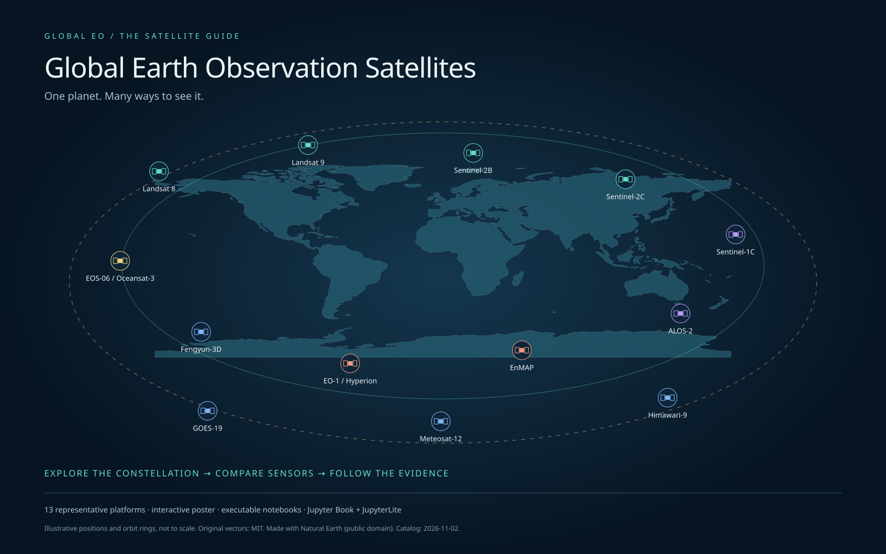

# Global Earth Observation Satellite Guide

[](https://jltobias.github.io/JupyterLite-EO-Satellite-Guide/explorer/)

**One planet. Many ways to see it.** A browser-based, interactive EO satellite poster, an executable Jupyter Book, and a JupyterLite laboratory for Earth observation students and practitioners.

**[Explore the poster](https://jltobias.github.io/JupyterLite-EO-Satellite-Guide/explorer/)** · **[Read the Jupyter Book](https://jltobias.github.io/JupyterLite-EO-Satellite-Guide/book/intro.html)** · **[Launch JupyterLite Lab](https://jltobias.github.io/JupyterLite-EO-Satellite-Guide/lab/index.html?path=01_constellation_poster.ipynb)** · [Source](https://github.com/jltobias/JupyterLite-EO-Satellite-Guide)

These are the configured GitHub Pages destinations. They become live after this work is pushed and the Pages workflow succeeds; local builds do not publish them. The repository is currently private; a public website needs the owner's publication decision and a GitHub plan that supports Pages for this repository. The [standalone HTML](downloads/eo-explorer.html) already opens directly from a local checkout without installation or internet.

## Explore, unfold and compare

The upper poster combines a global map with a selectable, schematic constellation and orbit rings. Click a satellite to expand or contract its mission record; unfold instruments and products for sensor method, spatial/spectral characteristics, temporal context, coverage, processing level and data-access links. Hover or focus a satellite or an attribute-table control to highlight the same platform in both views.

The lower poster provides a linked mission index and a comparison matrix. Pin multiple platforms, search capabilities, filter by agency, sensor family, orbit, status, observed property or application, export a contextual CSV, and print with an A1 landscape stylesheet. Legends use colour, central icon shapes and text. Keyboard controls include Tab, Enter/Space and Escape.

The initial catalog contains **13 representative platforms**: Landsat 8/9, Sentinel-2B/2C, Sentinel-1C, ALOS-2, EnMAP, EO-1/Hyperion, Fengyun-3D, EOS-06/Oceansat-3, GOES-19, Meteosat-12 and Himawari-9. It is a teaching snapshot verified **2026-11-02**, not an exhaustive constellation or live operations feed. Payload lists are selective; missing values stay explicit. Positions, orbit rings and relative distances are illustrative, not ephemerides or a scale model.

## Learn in the browser

| Notebook | Investigation |
|---|---|
| [01 · Constellation poster](notebooks/01_constellation_poster.ipynb) | Embed and explore the full interactive map, metadata, table and comparison |
| [02 · Sensor comparison](notebooks/02_sensor_comparison.ipynb) | Query the local catalog, follow field-level evidence and export comparisons |
| [03 · Hyperspectral land](notebooks/03_hyperspectral_land.ipynb) | Interactive synthetic spectra, band averaging, Hyperion and EnMAP, radiance versus reflectance |
| [04 · Orbits and resolution](notebooks/04_orbits_and_resolution.ipynb) | Interactive generic orbit geometry; period, repeat, scan cadence and resampling |
| [05 · Observation to public health](notebooks/05_observation_to_public_health.ipynb) | Trace Philadelphia heat evidence; interpret HELIX, Jackson and contextual OSM examples |
| [06 · Knowledge graph and curation](notebooks/06_knowledge_graph_and_curation.ipynb) | Validate sources and export a small SOSA/DCAT/PROV application profile |

JupyterLite runs Python locally in the browser; no account, API key or server kernel is needed. **First launch downloads Pyodide.** The standalone explorer needs no remote assets and works offline; the first-load Python runtime is not bundled. See [offline and publishing instructions](book/offline.md). Notebook simulations use synthetic data and do not imply validated remote-sensing or health results.

## Build locally

Use Python 3.11-3.13 from the repository root:

```bash
python -m pip install -r requirements.txt
python scripts/validate.py
python scripts/build.py --execute
python -m http.server 8000 --directory _site
```

Open [the local home page](http://localhost:8000/), [poster](http://localhost:8000/explorer/), [Book](http://localhost:8000/book/intro.html), or [Lab](http://localhost:8000/lab/index.html?path=01_constellation_poster.ipynb). `python scripts/build.py --prepare` refreshes shared assets without a full build. Source notebooks remain clean; executed outputs go into the Book build. Jupyter Book v1 is intentionally pinned for this Sphinx/MyST pipeline; it is in maintenance mode. [Book documentation](https://jupyter-book.readthedocs.io/v1/intro.html).

For browser checks:

```bash
python -m pip install -r requirements-dev.txt
python -m playwright install chromium
python scripts/test_browser.py
```

The browser test starts its own local server, checks map/table brushing, details, filters, pins, CSV export, keyboard interactions, mobile layout and offline first load, and saves screenshots under `tmp/qa/`.

## Publish the Book and Lab

The [GitHub Pages workflow](.github/workflows/pages.yml) validates the catalog, executes lessons, builds both environments and deploys `_site`. In GitHub repository **Settings → Pages**, choose **GitHub Actions**. Push to `main` to run the workflow; its published paths match the README links. Manual builds are also available from Actions. The generated site includes an offline ZIP with the HTML, catalog exports and attributions.

## Sources, citations and image attribution

The splash is **original SVG artwork** using public-domain [Natural Earth](https://www.naturalearthdata.com/about/terms-of-use/) land geometry, credited to Tom Patterson, Nathaniel Vaughn Kelso and contributors. The source is [assets/global-eo-splash.svg](assets/global-eo-splash.svg). The supplied raster diagram's original author/license could not be established, so it is not redistributed or used as a factual source.

Mission and instrument summaries cite official [USGS Landsat](https://www.usgs.gov/landsat-missions/landsat-8), [ESA/Copernicus SentiWiki](https://sentiwiki.copernicus.eu/), [JAXA ALOS-2](https://www.satnavi.jaxa.jp/ja/project/alos-2/), [EnMAP](https://www.enmap.org/mission/), [CMA/NSMC](https://www.nsmc.org.cn/nsmc/en/operation/status.html), [ISRO EOS-06](https://www.isro.gov.in/EOS_06.html), [NOAA GOES-R](https://www.ncei.noaa.gov/products/goes-terrestrial-weather-abi-glm), [JMA Himawari](https://www.jma.go.jp/jma/jma-eng/satellite/), and [EUMETSAT MTG](https://www.eumetsat.int/meteosat-third-generation) / [WMO OSCAR](https://space.oscar.wmo.int/satellites/view/meteosat_12) documentation. The full titles, dates, URLs and evidence mappings are in [data/catalog.json](data/catalog.json) and generated into the Book and offline poster.

The hyperspectral lesson adapts concepts from **McCullum, Torres-Perez and Bengtsson (NASA ARSET, 26 January 2021), _Hyperspectral Data for Land and Coastal Systems_, Part 2**, especially pp. 8-20 and 24-26. [Original NASA PDF](https://appliedsciences.nasa.gov/sites/default/files/2021-01/Hyperspectral_Part2_Final.pdf). It uses original synthetic spectra; no slide images are copied. The supplied implementation plan informs the [feature coverage and extension notes](book/implementation.md).

The traced heat application cites **Johnson, Wilson and Luber (2009)**, [doi:10.1186/1476-072X-8-57](https://doi.org/10.1186/1476-072X-8-57). Its historical Landsat input is distinguished from Landsat 8/9 teaching analogues. Additional study, ontology, OSM and software credits are in **[ATTRIBUTIONS.md](ATTRIBUTIONS.md)**. External sources retain their own terms; the [MIT license](LICENSE) covers original repository work.

## Extend the guide

Edit the canonical JSON and source notebooks, retain source IDs and verification dates, then validate and rebuild. [The application profile](book/data-model.md) specifies required fields, status values, units, unknowns and semantic scope. Add national, commercial or planned missions only after source curation. Full payload manifests, validated ontology mappings, a bundled offline Python runtime and classroom/assistive-technology evaluations remain documented extensions.
