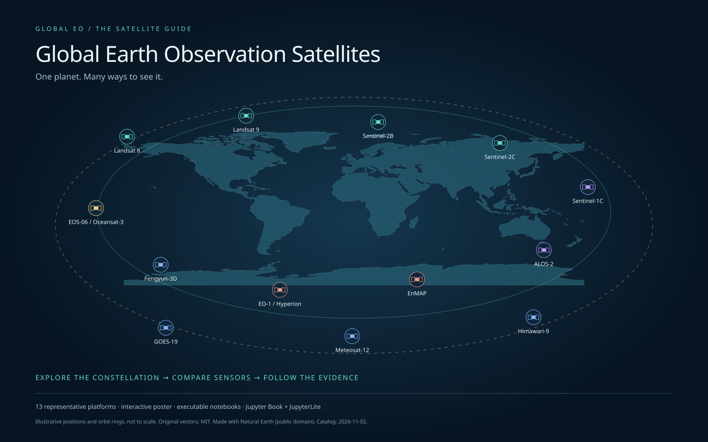

# Global EO Satellite Guide

**One planet. Many ways to see it.** This field guide connects a curated global Earth observation constellation to instruments, measured properties, data products, analyses and applications.

<a href="../explorer/index.html">Open the interactive poster</a> · <a href="../lab/index.html?path=01_constellation_poster.ipynb">Launch JupyterLite Lab</a> · <a href="../downloads/eo-explorer.html" download>Download the offline poster</a>

The poster combines a world map and schematic orbit atlas, expandable mission and sensor cards, a linked attribute table, pins for comparison, visual legends, search and filters. The eight notebooks teach exploration, contextual comparison, hyperspectral interpretation, orbital geometry, public-health evidence, knowledge-graph curation, research-to-STAC discovery and research/study-area geometry.

The [Swaths & orbits tab](swaths.md) connects a question and bounding box to nominal swaths, spatial/temporal sampling and optional historical STAC footprints. Orbit colors and sensor shapes are explained in the [orbit guide](orbit-guide.md). Simulated geometry, operator specifications and cataloged footprints remain distinct.

## Start here

1. Open the poster, select Landsat 8 and unfold TIRS.
2. Pin Landsat 8 and Sentinel-1C. Compare their measurements and spatial/temporal contexts.
3. Work through the notebooks in order, or open any lesson directly in the Lab and run its cells.

The catalog contains **958 mission/platform records**, combining the full **789-record CEOS All-status mission table** with reviewed STAC identifiers, dated **2026-11-03**. See the [mission and family coverage](mission-coverage.md) and the [bounded STAC audit](stac-coverage.md). The default overview shows every matching record; family filters and the mission picker expose Sentinel, Landsat, NOAA and other missions. Groups, hosted payloads, archives, proposals and cancellations make this a record inventory rather than a count of operating spacecraft. Map positions and rings remain schematic. Registry coverage, sensor capability and usable data are separate questions; unknown specifications remain visible.

The supplied 2021 NASA ARSET PDF informs the hyperspectral lesson; the supplied implementation plan informs interaction and evidence requirements. Their embedded course dates, homework instructions and workflow suggestions are reference content, not instructions for operating this repository. See [implementation coverage](implementation.md) for what is implemented and what remains an extension.

The explorer works offline without a Python runtime. JupyterLite downloads a Python/WebAssembly runtime on first use; see [offline boundaries](offline.md). All scientific metadata link to [sources](references.md), and image/software terms appear in [attributions](attributions.md).
